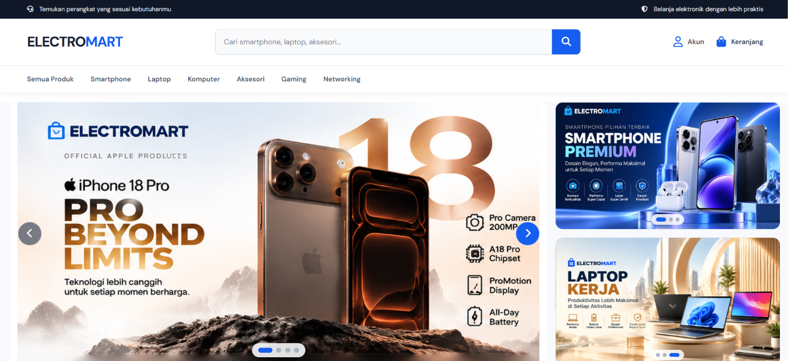
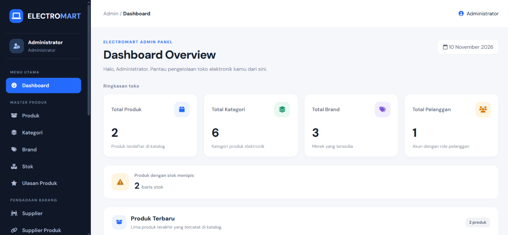
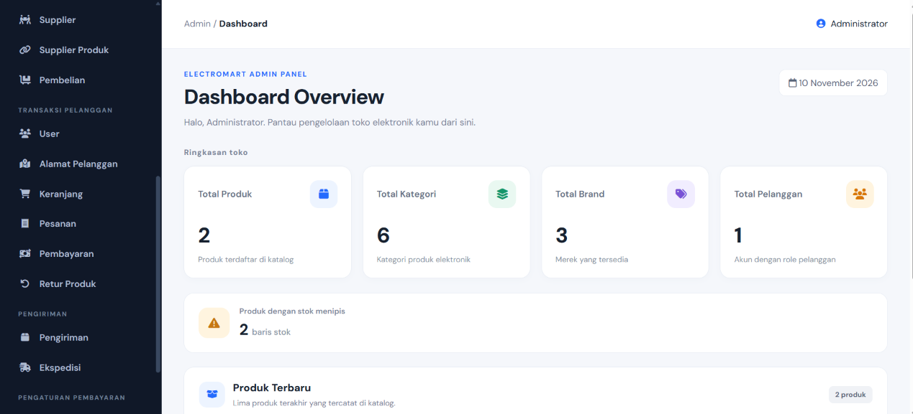

# ELECTROMART

### Aplikasi E-Commerce Barang Elektronik

*Temukan perangkat yang sesuai kebutuhanmu, belanja elektronik jadi lebih praktis.*

 

**Mata Kuliah:** E-Commerce &nbsp;|&nbsp; **Kelompok 7**

---

## Tim Pengembang

**Kelompok 7**, Mata Kuliah E-Commerce

<table>
  <tr>
    <th>No</th>
    <th>Nama</th>
    <th>NIM</th>
    <th>GitHub</th>
    <th>Branch</th>
  </tr>
  <tr>
    <td align="center">1</td>
    <td>Muhammad Firdaus Al-Ayubi</td>
    <td>2522105012</td>
    <td><a href="https://github.com/MuhammadFirdausAlAyubi">@MuhammadFirdausAlAyubi</a></td>
    <td><code>Ayub</code></td>
  </tr>
  <tr>
    <td align="center">2</td>
    <td>Farrel Andrea Carrvaro</td>
    <td>2522105091</td>
    <td><a href="https://github.com/Lerrrss">@Lerrrss</a></td>
    <td><code>Farrel</code></td>
  </tr>
  <tr>
    <td align="center">3</td>
    <td>Muhammad Fahmi Ramadhan</td>
    <td>2522105033</td>
    <td><a href="https://github.com/fahmialxstardiee">@fahmialxstardiee</a></td>
    <td><code>ami</code></td>
  </tr>
  <tr>
    <td align="center">4</td>
    <td>Devandira Kaila Wibisana</td>
    <td>2522105016</td>
    <td><a href="https://github.com/Devandira">@Devandira</a></td>
    <td><code>Devan</code></td>
  </tr>
  <tr>
    <td align="center">5</td>
    <td>Didik Saputra</td>
    <td>2522105021</td>
    <td><a href="https://github.com/saputradidik112-lab">@saputradidik112-lab</a></td>
    <td><code>Didik</code></td>
  </tr>
</table>

---

## Tentang Project

**ELECTROMART** adalah aplikasi e-commerce yang berfokus pada penjualan barang elektronik secara online. Aplikasi ini dibuat untuk memudahkan pengguna dalam **melihat produk**, **melakukan pembelian**, dan **mengelola transaksi**, mulai dari smartphone, laptop, komputer, aksesori, gaming, hingga perangkat networking.

Aplikasi memiliki dua sisi pengguna:

| Peran | Kegunaan |
|-------|----------|
| **Pelanggan** | Menjelajah katalog, memfilter produk, mengelola keranjang, checkout, dan memantau pesanan |
| **Admin** | Mengelola produk, stok, supplier, pesanan, pembayaran, pengiriman, dan retur |

---

## Tujuan Project

Membangun aplikasi E-Commerce barang elektronik sebagai salah satu bentuk penerapan ilmu **pemrograman web** dan **pengelolaan database**.

---

## Fitur Utama

### Sisi Pelanggan

- Halaman utama dengan produk terbaru
- Katalog produk per kategori: **Smartphone, Laptop, Komputer, Aksesori, Gaming, Networking**
- Filter produk berdasarkan **rentang harga** dan **brand** (brand otomatis menyesuaikan kategori yang dibuka)
- Detail produk lengkap dengan foto, varian, stok, dan ulasan
- Ulasan dan rating produk
- Keranjang belanja
- Checkout dan pilihan alamat pengiriman
- Riwayat dan detail pesanan
- Pengajuan retur produk
- Manajemen akun: profil, ganti password, dan alamat

### Sisi Admin

- Dashboard
- CRUD **Produk**, **Kategori**, dan **Brand**
- Manajemen **Stok**
- Manajemen **Supplier**, **Supplier Produk**, dan **Pembelian**
- Manajemen **Pesanan**, **Pembayaran**, dan **Pengiriman**
- Pengelolaan **Retur Produk**
- Pengaturan **Ekspedisi** dan **Bank**
- Manajemen **User** dan **Alamat**
- Moderasi **Ulasan Produk**

---

## Tampilan Aplikasi

### Tampilan User

  
   
  <b>Halaman Utama</b>

### Tampilan Admin

<table>
  <tr>
    <td align="center" width="50%">
       
      <b>Dashboard Admin</b>
    </td>
    <td align="center" width="50%">
       
      <b>Menu Pengelolaan Admin</b>
    </td>
  </tr>
</table>

---

## Teknologi yang Digunakan

| Kategori | Teknologi |
|----------|-----------|
| Framework | Laravel |
| Bahasa Pemrograman | PHP |
| Database | MySQL |
| Template Engine | Blade |
| Front-End | HTML, CSS, JavaScript |
| Version Control | Git dan GitHub |